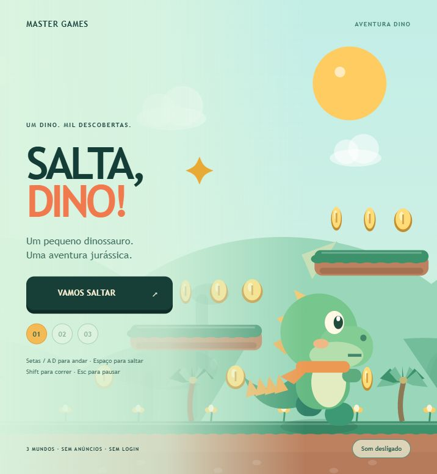

# Salta, Dino!

Jogo de plataformas original de Master-Devs171. Três fases: Vale dos Dinossauros, Dunas dos Fósseis e Vulcão da Lua. Recolhe moedas, salta sobre escaravelhos e chega ao portal. Há uma bandeira a meio de cada fase e tentativas ilimitadas.

## Controlos

- A/D ou setas: andar; Shift: correr.
- Espaço, W ou seta para cima: saltar. Segurar aumenta a altura.
- Esc ou botão: pausa. Controlos multitoque no telemóvel.

O jogo guarda as fases desbloqueadas neste navegador. Não exige conta, rede, anúncios nem compras. Gráficos desenhados em Canvas e pequenos sons sintetizados são originais; não usa recursos ou personagens de Mario/Nintendo. Código e gráficos sob MIT.

`npm test` verifica física, moedas, bandeiras, inimigos e a conclusão das três fases. `npm run dev` serve o jogo em http://127.0.0.1:8791/.

Tema Dino: personagem dinossauro verde com cauda e placas dorsais, palmeiras, silhuetas de saurópodes, vulcões e fósseis decorativos. O tema mantém a física e a progressão das três fases.

## Publicação e app

[Jogar agora](https://salta-nico-master171.master-171.chatgpt.site/) · [Código no GitHub](https://github.com/Master-Devs171/dinoplay-salta-dino)

Pacote DinoPlay: manifest.json aponta para dist/index.html. Inclui o SDK local, guarda progresso através da app quando integrado e permite voltar à biblioteca. Fora da app funciona sem login e guarda o progresso neste dispositivo. Idioma atual: português. Todos os recursos de execução são locais; sem anúncios, pagamentos ou serviços externos.

Validação: node scripts/validate.mjs. Desenvolvimento: npm run dev. Testes: npm test.
